# 🇫🇷 France Secrète

<p align="center">
  <strong>REDÉCOUVREZ LA FRANCE, UN SECRET À LA FOIS.</strong><br>
  Des châteaux majestueux aux paysages confidentiels, partez à la rencontre d’une France inattendue.
</p>

<p align="center">
  <strong>LE GUIDE DES BEAUTÉS CACHÉES DE FRANCE</strong><br>
  <em>Des lieux d’exception, des paysages inattendus et un patrimoine à redécouvrir.</em>
</p>

<p align="center">
  <a href="https://coco921609.github.io/france/"><strong>Découvrir l’application</strong></a>
  &nbsp;·&nbsp;
  <a href="https://play.google.com/store/apps/details?id=com.france_secrete.france_secrete"><strong>▶ Télécharger sur Android</strong></a>
  &nbsp;·&nbsp;
  <a href="https://coco921609.github.io/france/"><strong> Découvrir sur iOS / Web</strong></a>
  &nbsp;·&nbsp;
  <a href="https://github.com/Coco921609/france"><strong>Code source</strong></a>
</p>

<p align="center">
  
  
  
</p>

---

## ✦ L’esprit France Secrète

**France Secrète** est une application Flutter dédiée à celles et ceux qui souhaitent découvrir une autre facette de la France. Des châteaux majestueux aux calanques confidentielles, des gorges spectaculaires aux panoramas grandioses, elle rassemble des lieux qui méritent le détour.

Son interface immersive, son univers sombre et ses accents lumineux accompagnent une exploration pensée comme un beau carnet de voyage numérique. L’application invite à découvrir des lieux emblématiques et des sites naturels moins connus, à son propre rythme.

## ✦ Trois univers à explorer

| UNIVERS | CE QUI VOUS ATTEND |
|:--|:--|
| 🏰 **Châteaux & patrimoine** | Domaines historiques, architectures remarquables et lieux chargés d’histoire |
| 🌊 **Calanques & littoral** | Criques, falaises, eaux turquoise et paysages côtiers |
| 🏞️ **Nature & grands paysages** | Canyons, gorges, cascades, lacs, forêts et panoramas |

## ✦ Un parcours pensé pour la découverte

| ÉTAPE | EXPÉRIENCE |
|:---:|:--|
| **01** | **Bienvenue** — découvrez l’univers de France Secrète |
| **02** | **Personnalisation** — choisissez vos préférences et créez votre profil |
| **03** | **Exploration** — parcourez les châteaux et les paysages |
| **04** | **Fiches de lieux** — approfondissez chaque découverte |
| **05** | **Favoris** — retrouvez les lieux que vous souhaitez garder |
| **06** | **Paramètres** — adaptez l’application et ses préférences |

## ✦ Le parcours de l’application

<p align="center">
  <strong>16 CAPTURES AUTHENTIQUES · 1 PAR ÉCRAN · 3 TEMPS DE DÉCOUVERTE</strong><br>
  <em>Du premier lancement à l’exploration des plus beaux lieux de France.</em>
</p>

### 01 / Entrer dans l’expérience

<sub>CHOIX DE LA LANGUE · PRÉSENTATION · CRÉATION DU PROFIL</sub>

| **01 — Choix de la langue** | **02 — Découvrir France Secrète** |
|:---:|:---:|
| <a href="docs/screenshots/01-choix-langue.png">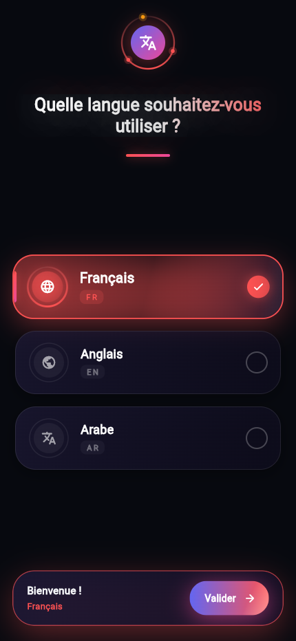</a> | <a href="docs/screenshots/02-presentation-decouverte.png">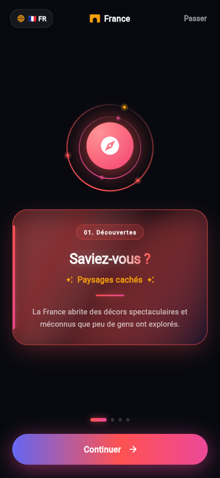</a> |
| **03 — Évasion** | **04 — Trésors insolites** |
| <a href="docs/screenshots/03-presentation-evasion.png">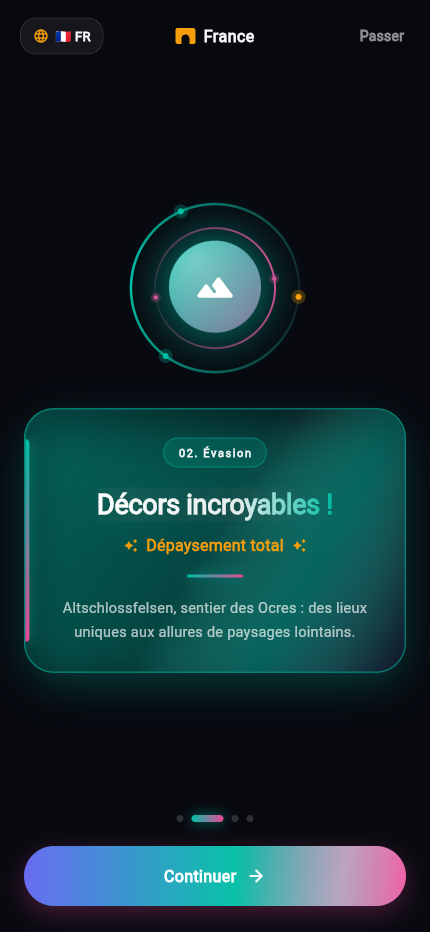</a> | <a href="docs/screenshots/04-presentation-insolite.png">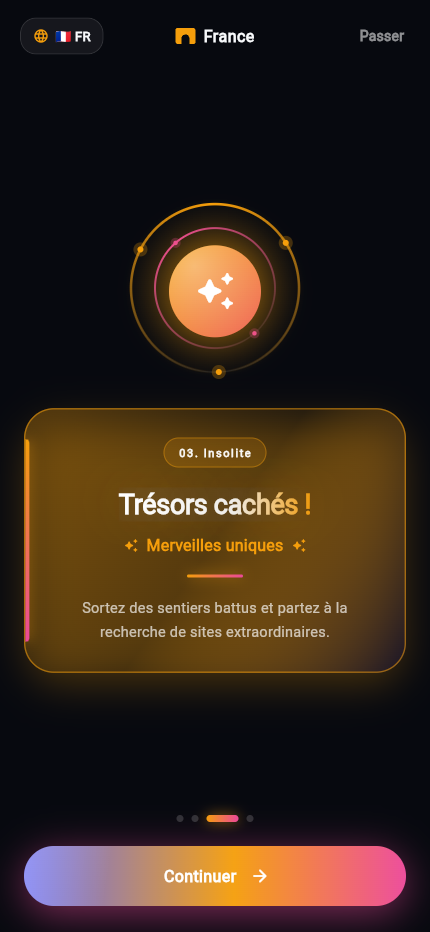</a> |
| **05 — Prêt à explorer** | **06 — Profil** |
| <a href="docs/screenshots/05-presentation-exploration.png">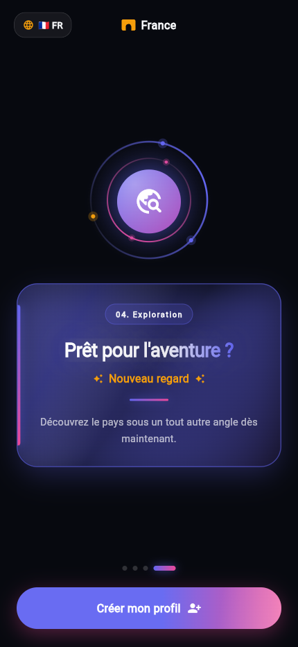</a> | <a href="docs/screenshots/06-profil.png">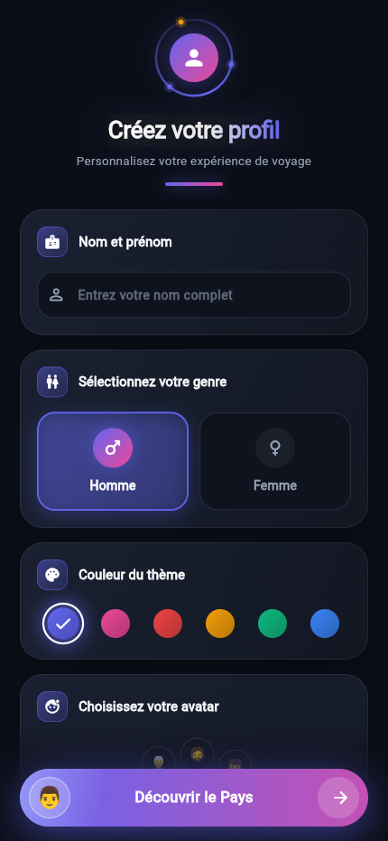</a> |

### 02 / Votre espace de découverte

<sub>ACCUEIL · PERSONNALISATION · FAVORIS</sub>

| **07 — Accueil** | **08 — Paramètres** | **09 — Favoris** |
|:---:|:---:|:---:|
| <a href="docs/screenshots/07-accueil.png">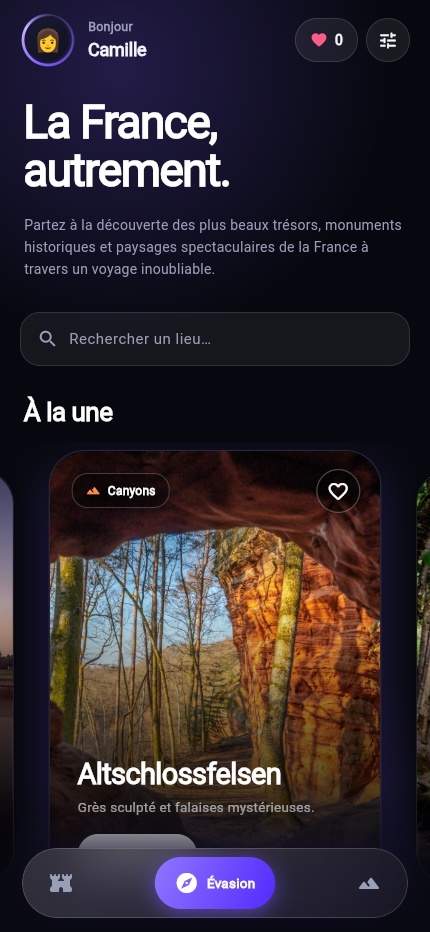</a> | <a href="docs/screenshots/08-parametres.png">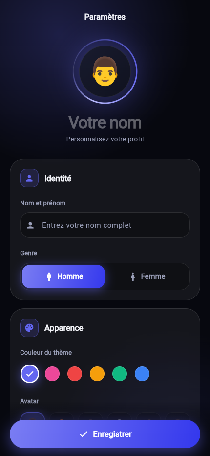</a> | <a href="docs/screenshots/09-favoris.png">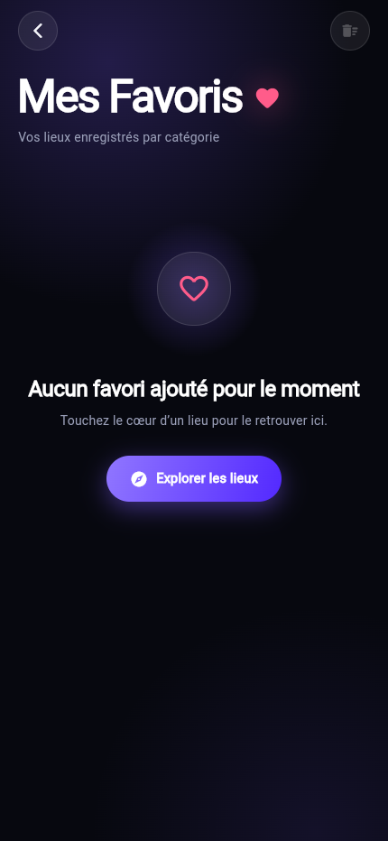</a> |

### 03 / Explorer les lieux

<sub>PATRIMOINE · CALANQUES · PAYSAGES · NATURE</sub>

| **10 — Château de Versailles** | **11 — Château de Chambord** |
|:---:|:---:|
| <a href="docs/screenshots/10-versailles.png">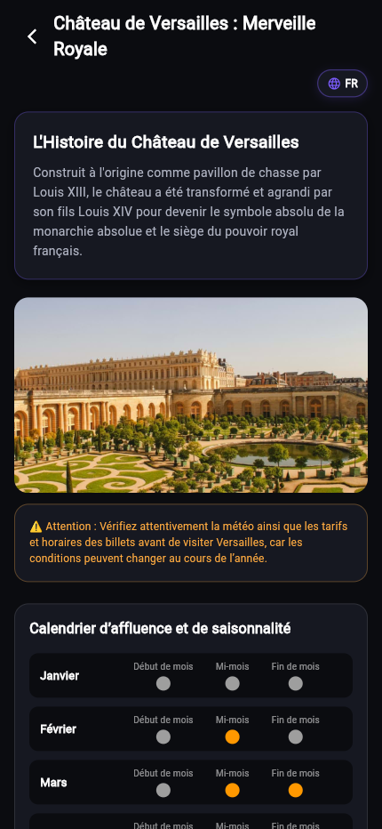</a> | <a href="docs/screenshots/11-chambord.png">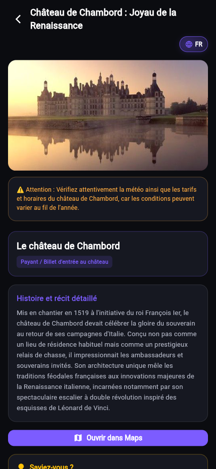</a> |
| **12 — Calanque de Sugiton** | **13 — Dune du Pilat** |
| <a href="docs/screenshots/12-calanque-de-sugiton.png">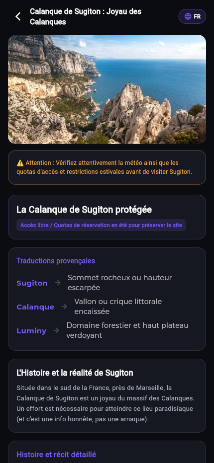</a> | <a href="docs/screenshots/13-dune-du-pilat.png">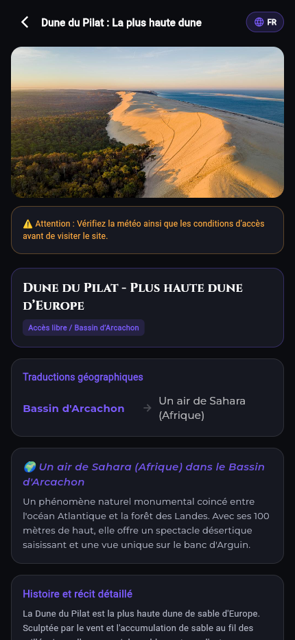</a> |
| **14 — Gorges du Verdon** | **15 — Étretat** |
| <a href="docs/screenshots/14-gorges-du-verdon.png">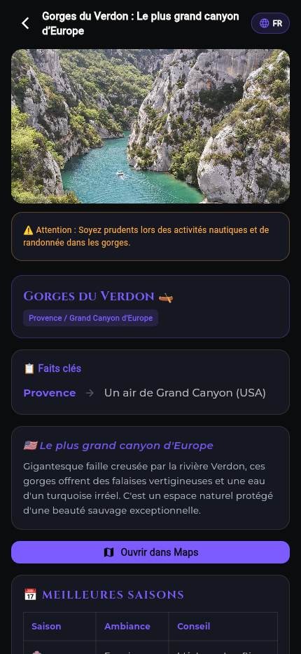</a> | <a href="docs/screenshots/15-etretat.png">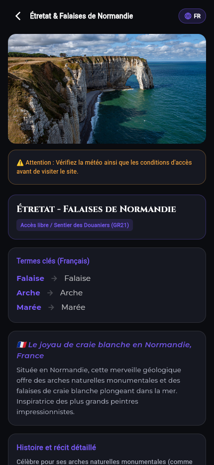</a> |
| **16 — Mont-Saint-Michel** | |
| <a href="docs/screenshots/16-mont-saint-michel.png">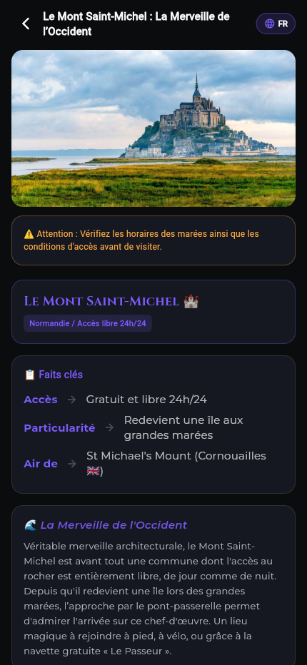</a> | |

<sub>Cliquez sur une image pour consulter la capture originale en grand format. Les captures sont générées depuis les véritables écrans Flutter, et non à partir de photographies promotionnelles.</sub>

## ✦ Fonctionnalités

- Découverte de lieux classés par grandes catégories.
- Sections dédiées aux châteaux, au patrimoine et aux paysages.
- Fiches détaillées pour les lieux présentés.
- Recherche et navigation dans les contenus.
- Gestion des favoris.
- Profil utilisateur et personnalisation.
- Interface disponible en français, anglais et arabe.
- Paramètres et préférences de l’application.

## ✦ Technologies

| TECHNOLOGIE | UTILISATION |
|:--|:--|
| **Flutter / Dart** | Application multiplateforme |
| **Material Design** | Composants et interface |
| **Google Fonts** | Typographie |
| **Flutter Map / Latlong2** | Cartographie |
| **Geolocator** | Localisation |
| **Shared Preferences** | Préférences locales |
| **Firebase** | Services Firebase et notifications |
| **GitHub Actions** | Déploiement Web et captures automatisées |
| **Playwright / Chromium** | Captures des écrans de l’application |

## ✦ Installer le projet

Prérequis : Flutter installé et configuré.

```bash
git clone https://github.com/Coco921609/france.git
cd france
flutter pub get
flutter run
```

Pour générer la version Web :

```bash
flutter build web --base-href "/france/"
```

## ✦ Retrouver France Secrète

- **Android — Google Play :** https://play.google.com/store/apps/details?id=com.france_secrete.france_secrete
- **iOS / Web :** https://coco921609.github.io/france/
- **Dépôt GitHub :** https://github.com/Coco921609/france
- **Documentation Flutter :** https://docs.flutter.dev/

---

<p align="center">
  <strong>FRANCE SECRÈTE</strong><br>
  <em>La beauté de la France se cache aussi hors des sentiers battus.</em>
</p>


## ✦ Ouvrir ce projet Flutter dans Android Studio

Ce guide explique comment récupérer **France Secrète**, installer les outils nécessaires et lancer le projet sur Windows, macOS (pour iOS) et Linux.

### 1. Télécharger le projet

Installez **Git**, **Flutter SDK** et **Android Studio** sur votre ordinateur. Ouvrez PowerShell, le Terminal macOS ou celui de Linux, puis exécutez :

```bash
git clone https://github.com/Coco921609/france.git
cd france
```

Le dossier `france` contient le fichier `pubspec.yaml` : c’est ce dossier qu’il faudra ouvrir dans Android Studio.

### 2. Installer et configurer Android Studio

1. Téléchargez Android Studio : https://developer.android.com/studio
2. Lancez l’installation et ouvrez Android Studio.
3. Dans **Settings / Preferences → Plugins → Marketplace**, recherchez et installez les plugins **Flutter** et **Dart** (l’installation de Flutter propose aussi Dart).
4. Redémarrez Android Studio.
5. Dans **SDK Manager**, installez un Android SDK récent ainsi que les outils de plateforme et de compilation Android.
6. Dans **Device Manager**, créez un émulateur Android ou connectez un téléphone avec le débogage USB activé.

Installez également le Flutter SDK depuis https://docs.flutter.dev/get-started/install et ajoutez son dossier `bin` à la variable PATH de votre système.

### 3. Configuration selon votre système

#### Windows

1. Installez Git : https://git-scm.com/download/win
2. Téléchargez et décompressez le Flutter SDK, par exemple dans `C:\\src\\flutter` (évitez les dossiers protégés).
3. Ajoutez `C:\\src\\flutter\\bin` au **PATH** de Windows : recherchez « Modifier les variables d’environnement système », ouvrez **Variables d’environnement**, sélectionnez **Path**, puis **Nouveau**.
4. Fermez et rouvrez PowerShell ou le terminal d’Android Studio.
5. Vérifiez l’installation :

```powershell
flutter --version
flutter doctor
```

6. Suivez les indications de `flutter doctor` pour terminer la configuration Android et accepter les licences :

```powershell
flutter doctor --android-licenses
```

#### macOS (Android et iOS)

1. Installez Git et Flutter en suivant https://docs.flutter.dev/get-started/install/macos
2. Installez Android Studio et les composants Android SDK décrits plus haut.
3. Pour compiler ou lancer l’application sur iPhone/iPad, installez **Xcode** depuis le Mac App Store.
4. Ouvrez Xcode une première fois, puis exécutez dans le Terminal :

```bash
sudo xcode-select --switch /Applications/Xcode.app/Contents/Developer
sudo xcodebuild -runFirstLaunch
flutter doctor
```

5. Pour tester sur un iPhone, connectez-le au Mac, faites confiance à l’ordinateur et activez le mode développeur si iOS le demande. Vous pouvez aussi créer un simulateur depuis Xcode.

#### Linux

1. Installez Git et les dépendances système requises par Flutter pour votre distribution. Consultez https://docs.flutter.dev/get-started/install/linux
2. Téléchargez et installez le Flutter SDK, puis ajoutez le dossier `flutter/bin` à votre PATH.
3. Installez Android Studio : https://developer.android.com/studio
4. Dans Android Studio, installez le SDK Android, les outils de compilation et les plugins Flutter et Dart.
5. Vérifiez la configuration et les licences :

```bash
flutter --version
flutter doctor
flutter doctor --android-licenses
```

**Important :** le développement et les tests Android/Web sont possibles sous Windows, macOS et Linux. La compilation et la signature d’une application iOS nécessitent un Mac avec Xcode ; Android Studio seul sur Windows ou Linux ne peut pas produire une version iOS.

### 4. Ouvrir France Secrète dans Android Studio

1. Démarrez Android Studio.
2. Cliquez sur **Open** (ou **Open an Existing Project**).
3. Sélectionnez le dossier cloné `france` — celui qui contient `pubspec.yaml`.
4. Attendez que le projet soit chargé.
5. Ouvrez le terminal intégré d’Android Studio et exécutez :

```bash
flutter pub get
```

### 5. Lancer l’application

Démarrez un émulateur dans **Device Manager** ou branchez un appareil compatible. Dans le terminal, vérifiez les appareils puis lancez l’application :

```bash
flutter devices
flutter run
```

Vous pouvez aussi sélectionner l’appareil dans la barre d’outils d’Android Studio et cliquer sur **Run ▶**.

Pour lancer la version Web dans un navigateur :

```bash
flutter run -d chrome
```

Pour générer le site Web de ce dépôt :

```bash
flutter build web --base-href "/france/"
```

### 6. En cas de problème

- Lancez `flutter doctor` et corrigez les éléments signalés.
- Vérifiez que le dossier `flutter/bin` est bien dans le PATH, puis redémarrez le terminal.
- Dans le dossier du projet, relancez `flutter pub get`.
- Si aucun appareil n’apparaît, vérifiez l’émulateur, le câble USB et le débogage USB avec `flutter devices`.
- Consultez la documentation officielle : https://docs.flutter.dev/

